<h1 align="center">
  <picture>
    <source media="(prefers-color-scheme: dark)" srcset="docs/assets/logo-dark.png">
    
  </picture>
</h1>

[](https://github.com/achird-labs/rift/actions/workflows/ci.yml)
[](https://github.com/achird-labs/rift/releases/latest)
[](https://crates.io/crates/rift-http-proxy)
[](https://hub.docker.com/r/zainalpour/rift-proxy)
[](https://achird-labs.github.io/rift/)

A [Mountebank](https://www.mbtest.dev/)-compatible HTTP/HTTPS mock server written in Rust. It loads your existing
`imposters.json` unchanged, keeps its throughput flat as the stub file grows, and embeds in-process in Java, Node,
Go and Scala.

<p align="center">
  
</p>

**[Documentation](https://achird-labs.github.io/rift/)**:
[getting started](https://achird-labs.github.io/rift/getting-started/),
[features](https://achird-labs.github.io/rift/features/),
[Mountebank compatibility](https://achird-labs.github.io/rift/mountebank/),
[SDKs](https://achird-labs.github.io/rift/sdk/),
[deployment](https://achird-labs.github.io/rift/deployment/),
[performance](https://achird-labs.github.io/rift/performance/).

```sh
docker run -p 2525:2525 -p 4545:4545 zainalpour/rift-proxy:latest

curl -X POST http://localhost:2525/imposters -H 'Content-Type: application/json' -d '{
  "port": 4545, "protocol": "http",
  "stubs": [{ "predicates": [{ "equals": { "path": "/hello" } }],
              "responses":  [{ "is": { "statusCode": 200, "body": "Hello, World!" } }] }]
}'

curl http://localhost:4545/hello   # Hello, World!
```

Also on Homebrew (`brew install achird-labs/rift/rift`), crates.io (`cargo install rift-http-proxy`) and
[GitHub Releases](https://github.com/achird-labs/rift/releases); SDKs for
[Java](https://achird-labs.github.io/rift/sdk/java/), [Node](https://achird-labs.github.io/rift/sdk/node/),
[Go](https://achird-labs.github.io/rift/sdk/go/) and [Scala](https://achird-labs.github.io/rift/sdk/scala/).

Rift is compatible with **Mountebank 2.9.5**: every engine change is checked against it by a [differential harness](conformance/differential/)
that sends both the same requests and fails on any difference that is not
[documented](https://achird-labs.github.io/rift/mountebank/differences/). Moving from the first stub of a 310-stub
imposter to the last costs Rift under 1% of its throughput; Mountebank loses 84%
([benchmarks](https://achird-labs.github.io/rift/performance/)).

Used by [zio-bdd](https://github.com/EtaCassiopeia/zio-bdd) and
[zio-openfeature](https://github.com/EtaCassiopeia/zio-openfeature).
[Contributing](CONTRIBUTING.md) · Apache 2.0.
